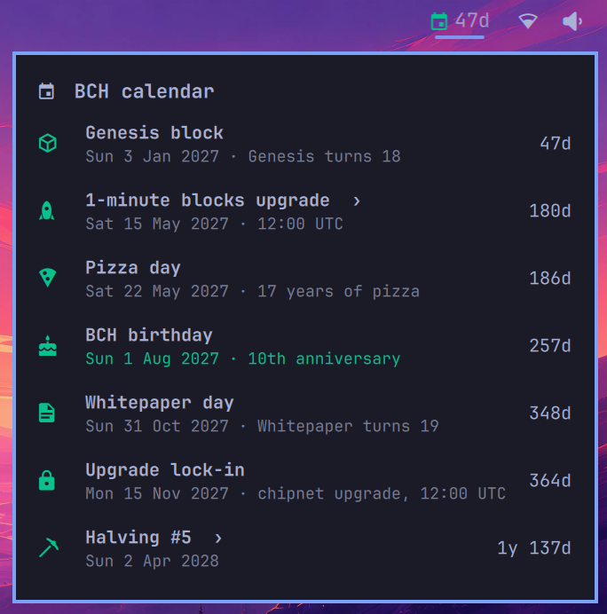
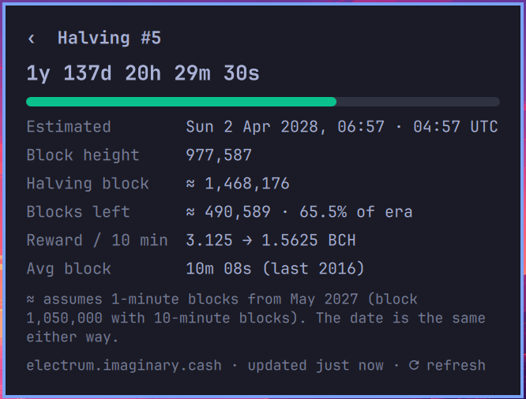
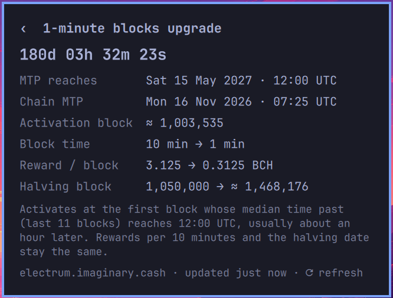

# BCH Calendar

A Bitcoin Cash calendar for the [Omarchy](https://omarchy.org) bar: the days
until the next BCH date in the bar, with a popup listing what's coming. That
includes the network upgrade and halving countdowns, read live from a
Fulcrum server.



## Dates

| Date | When |
| --- | --- |
| **Network upgrade** | 15 May, 12:00 UTC. 2027 is the **1-minute blocks upgrade** ([CHIP-2025-03](https://gitlab.com/0353F40E/fablous)) |
| **Upgrade lock-in** | 15 November, 12:00 UTC: the next May upgrade is frozen and goes live on chipnet |
| **Halving** | Estimated from the chain tip, about every four years |
| **BCH birthday** | 1 August 2017, the day Bitcoin Cash split off (2027 is the 10th anniversary) |
| **Whitepaper day** | 31 October 2008 |
| **Genesis block** | 3 January 2009 |
| **Pizza day** | 22 May 2010 |

The list is sorted by date, soonest first. A date is shown as **today** for
its whole local day and then moves to next year. The upgrade and the halving
also keep their day once they happen ("activated at block …", "halved at
block …") and roll over at midnight. Round anniversaries are highlighted.

## Details pages

The halving and the 1-minute blocks upgrade each open a details page with a
countdown that ticks every second.

| Halving | 1-minute blocks upgrade |
| --- | --- |
|  |  |

- **Halving:** estimated date (local time and UTC), block height, halving
  block, blocks left, progress through the current era, reward per 10 minutes,
  and the average block time over the last 2016 blocks.
- **1-minute blocks upgrade:** the moment the chain's median time past (MTP)
  reaches 12:00 UTC, the chain's current MTP, the expected activation block,
  and what changes: block time, reward per block, and the halving block.

Both pages end with the Fulcrum server in use, the time of the last update,
and a refresh link.

## Ready for 1-minute blocks

CHIP-2025-03 moves BCH from 10-minute to 1-minute blocks in May 2027. The
plugin follows the CHIP's tick model, where a tick is one second of target
time: every block up to the activation block adds 600 ticks, and every later
block adds 60. Halvings stay on the original 126,000,000-tick grid, so:

- **The halving date doesn't move.** Its ETA is the tip's time plus the ticks
  left, and that's correct on either side of the switch.
- **The halving block does move,** from 1,050,000 to about 1,468,000. It's
  shown with ≈ until the activation block is on chain, and exact after that.
- **The activation block is found on the chain.** Once the tip's MTP passes
  the activation time, the plugin binary-searches for the first block whose MTP
  reaches it. MTP never decreases, so the search is sound. This was tested on
  chipnet, which switched on 2026-11-15 at block 332,450.

The ETA assumes 600 seconds per block. ASERT, BCH's difficulty adjustment,
steers the chain back to that schedule, so this is more reliable than
extrapolating the recent average. That's why other countdowns can be days
apart from this one.

## Install

```bash
omarchy plugin add https://github.com/mr-zwets/omarchy-bch-calendar.git
```

You'll be asked to review, enable and place it. To do it non-interactively:

```bash
omarchy plugin add https://github.com/mr-zwets/omarchy-bch-calendar.git --enable --yes
```

Move it in the bar, for example next to the clock:

```bash
omarchy bar move mrzwets.bch-calendar --after omarchy.clock
```

Update or remove:

```bash
omarchy plugin update mrzwets.bch-calendar
omarchy plugin remove mrzwets.bch-calendar
```

### Requirements

- **Node.js** on the shell's `PATH`, which runs `fetch.mjs`. A stock Omarchy
  already has it as a dependency of `yt-dlp`. If not, install it with
  `omarchy pkg add nodejs`.
- A Nerd Font for the icons. Omarchy ships one.

## Usage

| Action | Result |
| --- | --- |
| Left-click the pill | Open or close the calendar |
| Click the halving or upgrade row | Open its details page; ‹ goes back |
| Click "refresh" on a details page | Fetch the chain state now |
| Middle-click the pill | Fetch the chain state now |

From a terminal or a keybinding:

```bash
qs ipc -p /usr/share/omarchy/shell call mrzwets.bch-calendar toggle
qs ipc -p /usr/share/omarchy/shell call mrzwets.bch-calendar halving   # open the halving page
qs ipc -p /usr/share/omarchy/shell call mrzwets.bch-calendar upgrade   # open the upgrade page
```

## Settings

All settings are optional. Add them to the widget's entry in
`~/.config/omarchy/shell.json`:

```json
{
  "id": "mrzwets.bch-calendar",
  "pill": "next",
  "servers": ["fulcrum.example.org:50002"],
  "pollSeconds": 600
}
```

| Setting | Default | Meaning |
| --- | --- | --- |
| `pill` | `"next"` | Which date the pill counts down to: `"next"`, `"upgrade"` or `"halving"`. A date that is today always takes over. |
| `servers` | Curated list | Fulcrum servers as `host` or `host:port` (TLS, port 50002 by default), tried in order. Point it at your own node. |
| `pollSeconds` | `600` | How often to fetch the chain state (minimum 60). |
| `network` | `"mainnet"` | `"chipnet"` uses chipnet servers and chipnet's activation time. |
| `oneMinuteActivation` | `1810382400` | Activation time (unix, MTP) for 1-minute blocks. `0` disables it, and the plugin then uses plain 10-minute math. |

## Network and privacy

The anniversaries need no network. The upgrade and halving rows come from the
chain:

- Every `pollSeconds`, `fetch.mjs` opens one TLS connection to a
  [Fulcrum](https://github.com/cculianu/Fulcrum) server, which speaks the
  Electrum protocol. It sends `server.version`,
  `blockchain.headers.subscribe`, and `blockchain.block.headers` for the last
  11 blocks and one block 2016 back, then disconnects. It sends no addresses
  and no wallet data; the server only sees your IP.
- Around the activation it sends about 15 more small header requests, once, to
  find the activation block.
- By default it uses the curated mainnet list from
  [Cashonize](https://github.com/cashonize/cashonize-wallet), trying each
  server in turn until one answers. Set `servers` to use your own.
- The last good result is cached in `~/.cache/bch-calendar-<network>.json`,
  so the bar has data right after login. A failed fetch never overwrites the
  cache, and it retries after 15s, 30s, 1m and so on.
- All text from the network is validated and shown as plain text.

## Development

```bash
node --test tests/       # tick model, halvings, rollover, formatting
node fetch.mjs --activation 1810382400                              # mainnet chain state
node fetch.mjs --activation 1794744000 chipnet.imaginary.cash       # chipnet, already activated
```

- `Model.js` holds all the logic. It's a QML `.pragma library` script with no
  QML types, so the tests load it with plain Node.
- `BarWidget.qml` is the pill and the popup, and `fetch.mjs` is the Fulcrum
  client, which has no dependencies.
- After editing `Model.js` or making structural QML changes, run
  `omarchy restart shell`. The shell evaluates a library script only once.

## License

[MIT](LICENSE)
